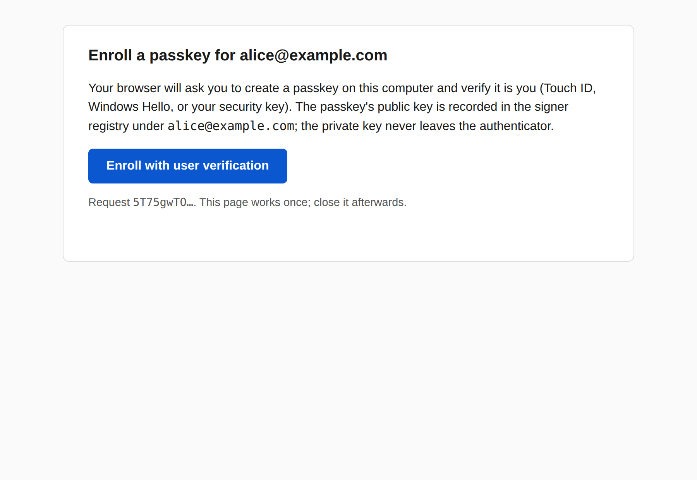
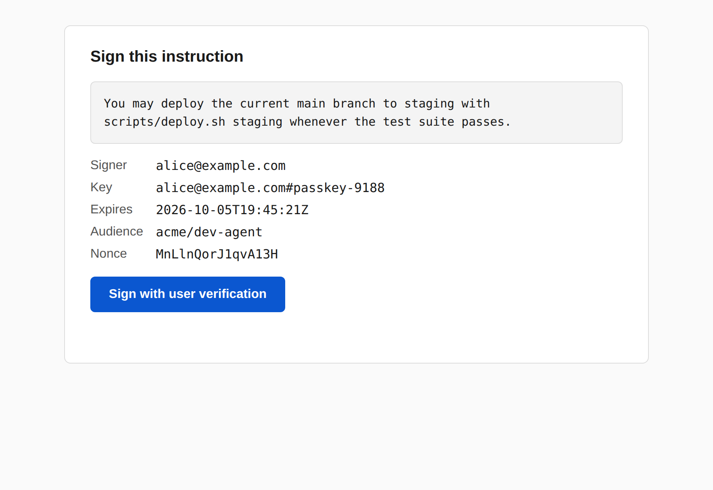
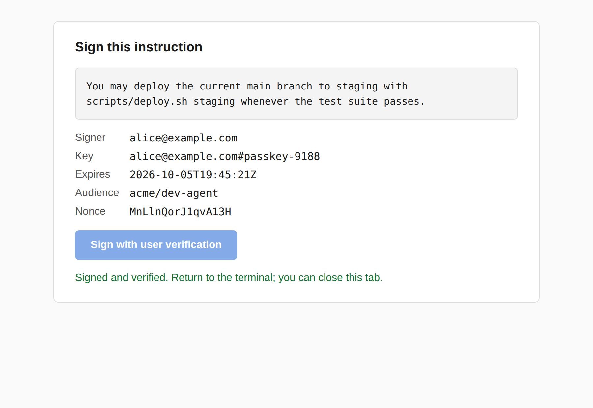

# Phase 2 findings: biometric signing via WebAuthn passkey

**Date:** 5 October 2026.

**Status:** implementation complete and exercised end to end in headless Chromium with a virtual authenticator (user verification on). Three acceptance items need the laptop and are pending: a Touch ID enrollment and signature, the recorded real assertion for the test suite, and the Scenario 1 and 2 re-runs in enforced mode, which also draw on the Claude subscription. The runner has the options for that re-run.

**Where things are:** verifier path in `sib/keys_webauthn.py` and `sib/verify.py`, the signing app in `sib/webauthn_app/`, CLI bridge in `sib/cli.py`, registry changes in `sib/registry.py`, the software authenticator in `tests/fake_authenticator.py`, tests in `tests/test_webauthn.py`, `tests/test_webauthn_app.py` and additions to `tests/test_cli.py` and `tests/test_hooks.py`, vectors in `docs/spec/vectors/webauthn_*.json`, the guide page `docs/guide/components/signing.qmd`, screenshots in `images/phase-2/`.

## What was built

- **Verifier path for `ES256-webauthn`.** The header gains three fields that
  carry the assertion (`credentialId`, `authenticatorData`, `clientDataJSON`);
  the WebAuthn challenge is the SHA-256 of the signing input over the header
  without them, so the authenticator's signature binds the exact header and
  canonical text. The checks run in the plan's order: client data type,
  challenge, origin, RP ID hash, UP and UV flags, AAGUID allowlist, then the
  ES256 signature over `authenticatorData || SHA-256(clientDataJSON)` with the
  enrolled COSE key through `py_webauthn`'s key helpers and `cryptography`.
  Four statuses were added: `uv_not_performed`, `authenticator_not_allowed`,
  `origin_not_allowed`, `rp_id_mismatch`. A challenge mismatch is
  `invalid_signature`, which is what a one-byte edit of the text produces. The
  spec and the conformance vectors (23 now, 9 for this path) are updated.

- **Signing app.** FastAPI on `127.0.0.1:7391`, started in a thread by the
  CLI for one request and stopped when it is answered. Two pages, no external
  resources. Enroll: `navigator.credentials.create` with user verification
  required, platform attachment, resident key preferred, attestation
  `direct`, ES256 only. Sign: the canonical text in a monospace box, signer,
  key, expiry, audience, nonce, one button; `navigator.credentials.get` with
  the fixed challenge and user verification required. Every request has a
  one-time token; a page that fails in the browser reports the error back so
  the CLI ends at once.

- **CLI bridge.** `sib enroll --signer` opens the enroll page and writes the
  registry entry (`alg: ES256-webauthn`, COSE public key, credential id,
  AAGUID, origins, RP ID, sign count, transports, attestation record,
  `attestation_verified`). `sib sign` prefers a signer's passkey, opens the
  sign page, runs the verifier over the assertion and writes a block only on
  `verified`; `--dev` picks a dev key. `sib verify --dev` and `--enforced`
  force a mode. The kid convention is `<signer>#passkey-<id>`.

- **Modes (NF-4).** With `SIB_MODE` unset, the verifier, the CLI and the
  hooks run in enforced mode once any passkey is enrolled and in dev mode
  before that. In enforced mode dev blocks are `dev_key_in_enforced_mode`,
  a block needs an audience, and no warning prints. The manifest span carries
  `alg` and `attestation_verified` so a classifier policy can require
  verified attestation.

- **Attestation.** Verified through `py_webauthn`. `attestation_verified` is
  true only when the statement carried a certificate chain and a root for
  its format was available: Apple's root is bundled for the `apple` format;
  `packed`, `tpm` and `fido-u2f` need roots in `SIB_ATTESTATION_ROOTS`.
  `SIB_REQUIRE_ATTESTATION=1` refuses unverified enrollments; the default
  accepts them and prints why they are weaker.

- **Allowlist.** `DEFAULT_ALLOWED_AAGUIDS` in `sib/keys_webauthn.py`: iCloud
  Keychain, Chrome on macOS, three Windows Hello entries, two YubiKey Bio
  entries, compiled from the public passkey AAGUID list, plus the all-zero
  AAGUID accepted only with verified attestation. A registry extends it under
  `allowed_aaguids`. The list is policy, and the docs say so; it should be
  checked against the public list before enforced use.

## Headless-browser run

The pages were exercised with Playwright driving headless Chromium and a CDP
virtual authenticator (CTAP2, internal transport, resident keys, user
verification on). The script runs the real `sib enroll --no-browser` and
`sib sign --no-browser` commands, opens the URL each prints, clicks the
button and waits for the page's result.








What happened, in order:

1. Enrollment succeeded. The virtual authenticator returned a `packed`
   attestation with a certificate chain and AAGUID
   `01020304-0506-0708-0102-030405060708`. No root was configured, so the
   entry has `attestation_verified: false` and `x5c_present: true`, and the
   CLI printed the two warnings: the AAGUID is not on the allowlist, and the
   hardware backing is an assumption.

2. `sib sign` with that key: the page reported `authenticator_not_allowed`
   and the command exited 1 without writing a block.

3. The AAGUID added under `allowed_aaguids`: `sib sign` produced a block in
   1.0 s wall time (0.5 s from the page opening to the assertion). `sib verify`
   in the default, now enforced, mode: `VERIFIED`, manifest mode `enforced`.
   `staging` edited to `production` in the block: `INVALID_SIGNATURE`, error
   "WebAuthn challenge does not match the header and canonical text". This
   block is the passkey example in the format specification.

4. User verification switched off on the virtual authenticator: Chromium
   refused the ceremony with `NotAllowedError` rather than returning an
   assertion with UV clear, the page reported it, and the CLI exited at once
   with the browser's message.

## Findings

- **A browser never produces a UV-clear assertion when UV is required.** The
  acceptance item "an assertion whose UV bit is cleared fails with
  `uv_not_performed`" is reached only by a crafted assertion presented
  directly to the verifier, which is what the tests and the vector do. The
  check still matters: the verifier is also given blocks from CLAUDE.md,
  tool results and transcripts, none of which came through a browser the
  harness controls.

- **The offered algorithms must be ES256 only.** `py_webauthn`'s default
  `pubKeyCredParams` lists EdDSA first, and the virtual authenticator created
  an Ed25519 credential; the first end-to-end sign then failed with
  `invalid_signature`. Enrollment now offers and accepts ES256 alone, since
  that is what `ES256-webauthn` names. Chromium logs a console warning that
  RS256 is not offered; it is informational, and the authenticators this
  phase targets all support ES256.

- **The virtual authenticator's attestation is a useful stand-in for a
  YubiKey.** It returns `packed` with a chain, so the "x5c present but no
  root configured" case was exercised for real, not only with the fake
  authenticator. The "chain verified against a configured root" case is
  covered by a test that mints a throwaway CA.

- **Token binding to the port.** The origin `http://localhost:7391` is
  recorded per key at enrollment and the assertion's origin is checked
  against it, so a signer who changes `SIB_WEBAUTHN_PORT` after enrolling
  gets `origin_not_allowed`. Per-signer origins, carried over from the plan,
  are the Phase 3 specification question the plan anticipated.

- **A fresh user handle per enrollment.** A reused user handle makes an
  authenticator replace its existing passkey for the site, which would
  orphan the key enrolled under the earlier `kid`. Each enrollment now uses a
  random handle and excludes the signer's existing credentials.

## Tests

83 tests pass, 1 skipped (`.venv/bin/python -m pytest -q`). New for this
phase: the header's WebAuthn field rules; every status on the WebAuthn path
including both flag bits, the zero-AAGUID rule, an added origin, the common
checks after a verified assertion, and a forged signature from another key;
enrollment with attestation `none`, `packed` self, `packed` with a chain to a
configured root (`attestation_verified: true`) and the same chain with no
root; refusals (UV clear, wrong challenge, `SIB_REQUIRE_ATTESTATION`); the
app's enroll and sign endpoints through FastAPI's test client, including the
one-time token, a wrong-kind token, a refused enrollment, an assertion that
fails and the abort path; the CLI bridge against a live server on a test
port; `sib enroll` and `sib sign` with the browser step answered by the fake
authenticator, key preference and `--dev`; the hooks in enforced mode with a
passkey block, a UV-clear block and a dev block, and `SIB_MODE=dev`
restoring the dev block. `test_recorded_real_assertion` is skipped until
`tests/fixtures/webauthn/real_assertion.json` exists; the signing guide says
how to record it.

The software authenticator (`tests/fake_authenticator.py`) produces real
ES256 assertions and registration responses with settable flags, AAGUID,
origin, RP ID and attestation format; it is what the conformance vectors are
generated with.

## Acceptance

| Criterion | Result |
|---|---|
| `sib sign` on the laptop prompts Touch ID and produces a block `sib verify` accepts in enforced mode; one changed byte fails with `invalid_signature` | Done in headless Chromium with a virtual authenticator (UV on): verified, then `invalid_signature` on the edit. **Touch ID run pending** on the laptop. |
| An assertion with the UV bit cleared fails with `uv_not_performed` | Yes, by test and vector; a browser refuses to produce one (see findings). |
| An assertion from an authenticator whose AAGUID is not allowlisted fails with `authenticator_not_allowed` | Yes: test, vector, and the real virtual-authenticator run before its AAGUID was added. |
| `docs/signing.md` states the UV, attestation, allowlist and password-fallback limits | `docs/guide/components/signing.qmd` (the docs are a Quarto site now). |
| `packed` attestation sets `attestation_verified: true`; Apple `none` sets it false; registry and manifest show the difference | Yes with a chain to a configured root (test); `none` and a chain without a root set false (test and the browser run). Manifest spans carry the flag. **A real YubiKey Bio and a real Apple passkey pending.** |
| Scenarios 1 and 2 pass in enforced mode with the same numbers as Phase 1 | **Pending**: needs a Touch ID signed block and the subscription. The hook-level equivalent is a test: a passkey block in CLAUDE.md reaches the classifier as a verified span in enforced mode, and a dev block is refused. |
| Time from `sib sign` to envelope under 15 s | 1.0 s wall with the virtual authenticator; Touch ID adds the human's touch. |

## Deviations from the plan

- Four new statuses rather than two. The plan asked for a distinct status per
  check; steps 1 and 2 map onto `malformed` and `invalid_signature`, and
  origin and RP ID got their own (`origin_not_allowed`, `rp_id_mismatch`)
  so a block signed on another port or site is named for what it is.

- The kid is not the credential id. The registry stores the credential id
  separately and the kid keeps the `<signer>#<label>` convention the docs
  describe, with `passkey-<first two bytes>` as the label; the header carries
  `credentialId` and the verifier requires it to match the entry.

- The app is not a daemon. The CLI starts it for one request and stops it,
  which is simpler and leaves nothing listening. A second `sib` command while
  one is waiting fails with a message naming the port.

- `sib enroll` keeps the Phase 1 manual path (`--public-key`) beside the
  browser path, and `sib verify` gains `--dev` to mirror `--enforced`.

- The signature segment is the authenticator's DER-encoded ECDSA signature,
  not the raw `r || s` form JWS ES256 uses, because that is what the
  authenticator returns and what every WebAuthn verifier expects. The
  specification says so.

- The `uvm` extension is requested and recorded in the registry when the
  browser supplies it (none of the tested browsers did); it is not carried in
  the block.

## What the laptop session must do

1. `sib enroll --signer <you>` with Touch ID; check that the registry entry's
   AAGUID is on the allowlist (iCloud Keychain passkeys report
   `fbfc3007-154e-4ecc-8c0b-6e020557d7bd`; Chrome's own passkeys
   `adce0002-35bc-c60a-648b-0b25f1f05503`) and record the attestation format
   it returned. Then `sib sign`, `sib verify`, and the one-byte edit. Note the
   time from command to envelope.

2. Record the assertion: write `tests/fixtures/webauthn/real_assertion.json`
   as the signing guide describes, and run the suite.

3. Re-run Scenarios 1 and 2 in enforced mode. Sign one block with an expiry
   that covers the batch and run:

   ```bash
   python3 scenarios/run_scenario.py --hooks sib --variant signed_claudemd -n 10 --claudemd-policy none \
     --sib-home "$SIB_HOME" --signed-block block.txt --results scenarios/results/phase2_s1.jsonl
   python3 scenarios/run_scenario.py --hooks sib --variant claudemd -n 10 --claudemd-policy none \
     --sib-home "$SIB_HOME" --results scenarios/results/phase2_s2.jsonl
   ```

   `--sib-home` copies the registry with the passkey into each run's
   `SIB_HOME` instead of creating a dev key, so the hooks run in enforced
   mode; `--signed-block` supplies the Touch ID signed block instead of
   signing per run. Add the result files to `RESULT_FILES` in
   `docs/scripts/pre-render.py` and the numbers to the table above.

4. If a YubiKey Bio is at hand: enroll it with its vendor root in
   `SIB_ATTESTATION_ROOTS` and confirm `attestation_verified: true`.
